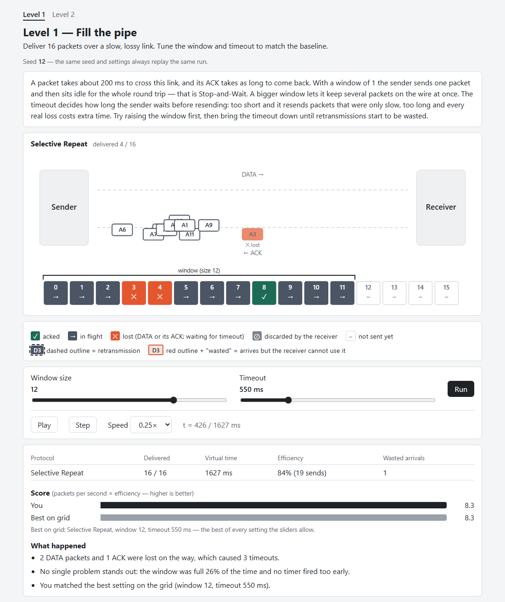
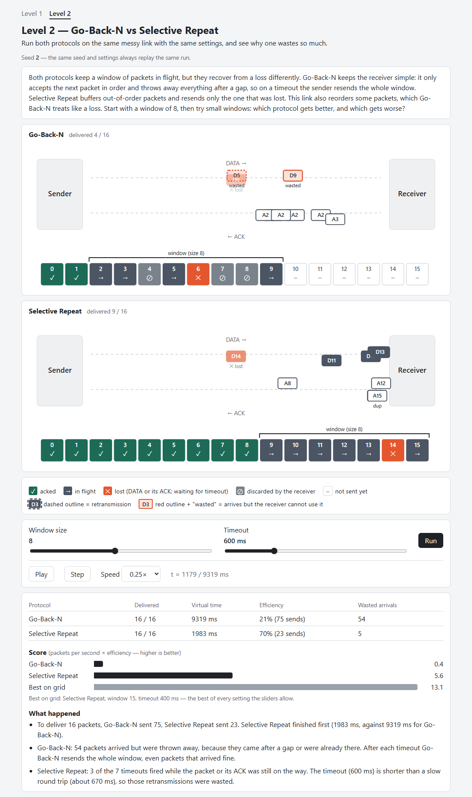
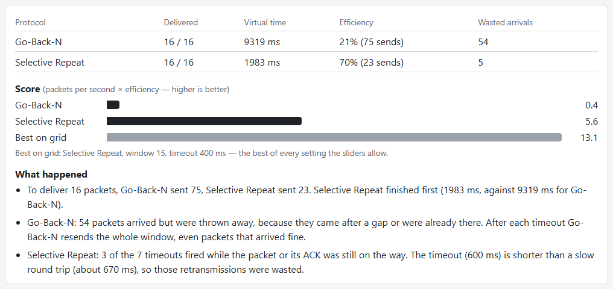

# PacketLab

A browser-only game that teaches how reliable data transfer works: acknowledgements, timeouts, retransmission, and the sliding window algorithm. The player acts as the protocol — tuning parameters, running a simulated lossy network, and comparing their score to a TCP-like baseline.

Everything runs in the browser. There is no backend. The final site is deployed to GitHub Pages.

| Level 1 — Fill the pipe | Level 2 — Go-Back-N vs Selective Repeat |
|---|---|
|  |  |

After every run the game explains what happened:



---

## Quick start

```bash
npm install
npm run dev      # open http://localhost:5173/packet-lab/  (debug log: /packet-lab/debug.html)
```

URL options: `?level=2` opens Level 2; `?loss=0.5` overrides the link's loss rate for a "what if" run (no baseline is computed on a custom link). `?loss=1` shows what happens when a run can never finish.

## Available scripts

| Command | What it does |
|---|---|
| `npm run dev` | Start the Vite dev server |
| `npm run build` | Produce a production build in `dist/` |
| `npm run preview` | Serve the production build locally |
| `npm test` | Run all Vitest unit tests |
| `npm run typecheck` | Run `tsc --noEmit` (type-check without emitting files) |
| `npm run lint` | Run ESLint across the whole project |
| `node scripts/screenshots.mjs <url>` | Re-capture `docs/*.png` from a running `vite preview` and report overflow at 360px (needs Chrome; set `CHROME_PATH` if it is not in the default Windows location) |

---

## Architecture rule

> **The simulation engine (`src/engine/`) must never touch the DOM or any browser API.**

The engine is pure TypeScript: it can run identically in Node (tests) and in the browser. The UI (`src/main.ts` and `src/ui/`) is the only layer allowed to touch the DOM. The UI reads the engine's output — an event log and a metrics object — and renders it; it never reaches into the engine's internals.

This separation means:

* Unit tests run in Node with no browser globals.
* The engine logic can be reasoned about and tested without any rendering.
* Future UI frameworks (canvas, SVG, React) can be swapped in without touching the engine.

---

## How it works

**Simulate first, animate later.** Whenever the player moves a slider, the whole simulation runs to completion immediately — it is deterministic and takes a few milliseconds. The result is an event log plus metrics. The UI then *replays* that log as an animation with play, pause, step and speed controls. Protocol code never knows it is being animated.

1. **Simulation** (`simulation.ts`) owns a virtual clock and a priority queue of events. It always runs the earliest event next, so no real time passes and runs are reproducible. A **safety stop** (120 s of virtual time or 200,000 events) ends runs that can never finish, such as a link that loses everything, and marks them `completed: false`.
2. **Links** (`link.ts`) decide what happens to each packet: drop, delay + jitter, duplicate, or reorder (hold back so later packets overtake). The forward (DATA) and reverse (ACK) links can be configured separately.
3. **Fair randomness.** Every transmission's fate comes from its own small random stream, seeded by a hash of *(seed, direction, sequence number, attempt number)*. So the 3rd transmission of packet 7 is lost, delayed or duplicated in exactly the same way whatever the window size, timeout or protocol. Comparing two settings therefore compares only the protocol's choices, not different luck.
4. **Protocols** (`protocols/`) implement a sender and a receiver. They only see an `EndpointCtx` (send, timers, clock, log) — never the simulation itself. Protocol settings (packet count, window, timeout) go to the protocol, not to the simulation.
5. **Event log.** The simulation logs every wire event (`send`, `retransmit`, `link-duplicate`, `drop`, `data-received`, `ack-received`) with a `wireId` per physical copy. Protocols log only their own decisions (`timeout`, `deliver`, `buffer`, `duplicate-dropped`, `out-of-order-dropped`). Every entry includes the packet, so DATA and ACK are never ambiguous.
6. **Replay** (`replay.ts`) pairs each departure with its arrival or drop into *flights*, and answers "what does the network look like at time t?" — packets on each lane, the state of every sequence number (not sent, in flight, lost, discarded, acked), and the sender's window. It understands Go-Back-N's cumulative ACKs and marks copies the receiver could not use as *wasted*.
7. **Scoring** (`scoring.ts`): score = goodput (packets per virtual second) × efficiency (useful ÷ total DATA transmissions). The baseline sweeps every window/timeout setting the level allows, for the same seed, and keeps the best — nothing is hardcoded.
8. **Insights** (`insights.ts`) turn the log and metrics into two or three plain sentences: what was lost and how many timeouts it caused, the main problem with the settings (timer shorter than the round trip, Go-Back-N throwing packets away, a full window, an over-cautious timeout), and how the run compares to the baseline.

## Levels

Levels are plain data in `src/levels/`: a seed, a link, the number of packets, the slider ranges, the protocols to run, and an intro paragraph.

* **Level 1 — Fill the pipe.** Selective Repeat on a slow link with 10% loss. Start as Stop-and-Wait (window 1) and find the window and timeout that match the baseline.
* **Level 2 — Go-Back-N vs Selective Repeat.** Both protocols on the same messy link (loss, duplication, reordering) with one set of controls. Go-Back-N's wasted transmissions are highlighted; a small window helps Go-Back-N while a large one helps Selective Repeat.

## Engine modules

| Module | Responsibility |
|---|---|
| `prng.ts` | Seeded PRNG (mulberry32) and `hashInts` for per-transmission seeds |
| `eventQueue.ts` | Min-heap of events ordered by (time, insertion order) |
| `packet.ts` | `Packet` and `LogEntry` types; the list of log event kinds |
| `link.ts` | One-directional lossy channel: drop, delay, jitter, duplicate, reorder |
| `simulation.ts` | Virtual clock, event loop, `EndpointCtx`, wire-event logging, safety stop |
| `metrics.ts` | Delivered, transmissions, efficiency, total time, losses, timeouts, waste — from the log |
| `protocols/stopAndWait.ts` | Stop-and-Wait sender and receiver |
| `protocols/slidingWindow.ts` | Selective Repeat: per-packet timers, buffering receiver, individual ACKs |
| `protocols/goBackN.ts` | Go-Back-N: one timer, whole-window resend, in-order-only receiver, cumulative ACKs |
| `protocols/registry.ts` | Protocol ids → name, constructors, and whether ACKs are cumulative |
| `replay.ts` | Event log → timeline of frames for animation |
| `scoring.ts` | Run a protocol with given settings, score it, sweep for the baseline |
| `insights.ts` | Plain-language explanations of a finished run |

## Project layout

```
src/
  engine/                 Pure TypeScript — no DOM (see table above)
  levels/
    level.ts              Level type, slider grid, and the level baseline
    level1.ts, level2.ts  Level data, including the intro text
    index.ts              The list of levels
  ui/
    svg.ts                Tiny helper for creating SVG elements
    linkView.ts           Sender/receiver, DATA and ACK lanes, moving packets
    packetStrip.ts        Per-seq state cells and the window bracket
    protocolPanel.ts      One protocol's link view + strip, with a live count
    player.ts             requestAnimationFrame playback of several timelines on one clock
  main.ts                 The game page: wires levels, engine and UI together
  debug.ts                debug.html — prints a raw Stop-and-Wait event log
  style.css
scripts/
  screenshots.mjs         README screenshots and the 360px overflow check
docs/                     Screenshots used in this README
tests/                    Vitest unit tests for every engine module
.github/workflows/        CI (lint, typecheck, test, build) and Pages deploy
```

---

## What I learned

*A first draft — edit this into your own words.*

* **Determinism makes everything testable.** A seeded PRNG and a virtual clock mean the same inputs always give the same event log, so every behaviour can be checked by a unit test instead of by watching an animation.
* **Separating "what happened" from "how to show it"** (simulate first, animate later) kept the protocol code small and let the UI, the replay and the explanations all read the same log.
* **Fair comparisons need care.** With one shared random stream, changing the window size quietly changed every packet's luck. Giving each transmission its own seed made results stable and comparable.
* **Go-Back-N vs Selective Repeat is a trade-off, not a winner.** Go-Back-N keeps the receiver trivial but resends whole windows; on a lossy, reordering link its best window is small, while Selective Repeat's is large.
* **A simulation needs a safety stop.** Some inputs (a link that loses everything) can never finish; limiting virtual time and event count turns a frozen tab into a clear message.

---

## Deployment

The site is deployed to GitHub Pages via `deploy.yml`. The Vite `base` option is set to `/packet-lab/`, which assumes the repository is named **`packet-lab`**. If you rename the repository, update the `base` value in `vite.config.ts` to match.

Enable Pages in the repository settings: **Settings → Pages → Source → GitHub Actions**.

---

## Stack

- **TypeScript 6** — strict mode, ESM, no `any`
- **Vite** — dev server and bundler
- **Vitest** — unit tests
- **ESLint + Prettier** — linting and formatting
- **GitHub Actions** — CI and Pages deployment
